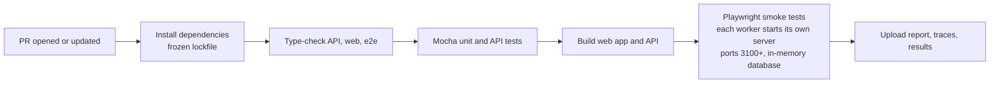

# PR open: source run

This project does one thing when a pull request is opened or updated: **build the app from source, start it as plain Node processes, and run the Playwright smoke tests against it.** The job fails if any step fails.

It deliberately excludes the other PR-open check (building and running the Docker image) and Jenkins, staging and post-deploy checks. Those live elsewhere so each pipeline's output stays easy to read.

## What happens



1. `./build.sh install` installs every workspace package from the committed lockfile.
2. `./build.sh compile` type-checks the API, the web app and the e2e package.
3. `./build.sh test` runs the Mocha tests (16).
4. `./build.sh build` produces `apps/web/dist` (the site) and `apps/api/dist` (the server).
5. Playwright installs Chromium and runs `--grep @smoke`. Each worker starts `apps/api/dist/server.js` on its own port with an in-memory database, tests against it, and stops it afterwards.
6. Reports and traces are uploaded whether or not the tests passed.

The workflow is [.github/workflows/pr-open-source.yml](.github/workflows/pr-open-source.yml), job name `e2e-source`. Make that job a required status check in branch protection if it should block merges.

## Run it locally

Needs Node 22+ (24 recommended), pnpm, and Git Bash or WSL on Windows. No Docker is needed.

```
./build.sh                                                           # install, compile, Mocha, build
pnpm --filter ai-ci-reference-e2e exec playwright install chromium   # once
pnpm --filter ai-ci-reference-e2e test:smoke                         # what the PR job runs
pnpm --filter ai-ci-reference-e2e test                               # full suite (optional)
```

Re-run `./build.sh build` after changing anything in `apps/`, because the tests run the compiled output.

## What is tested

| Suite | Tests | Command |
|---|---|---|
| Mocha (unit and API, no browser) | 16 | `./build.sh test` |
| Playwright smoke (the PR job) | 3: dashboard shows the seeded runs, a created run persists after reload, API health | `test:smoke` |
| Playwright full | 16 plus 1 deliberately skipped demo failure | `test` |

## Test data and isolation

- Playwright runs tests in parallel. Each worker gets **its own app instance and its own in-memory database**, so one test's data can never affect another worker's.
- Before every test, an automatic fixture calls `POST /api/test/reset` to restore the seed data for that worker's database.
- The reset endpoint is enabled only on these test servers (`ENABLE_TEST_RESET=true` is set by the fixture), never in a deployed environment.

## Artifacts

| Where | What | Produced |
|---|---|---|
| `e2e/playwright-report/` | HTML report (`pnpm --filter ai-ci-reference-e2e exec playwright show-report`) | Every run |
| `e2e/test-results/junit.xml` | Machine-readable results | Every run |
| `e2e/test-results/<test>/` | Screenshot, `trace.zip`, `error-context.md` | Failed tests only |

In GitHub Actions these are uploaded as the artifact `playwright-diagnostics` (kept 7 days). Open a trace with `pnpm --filter ai-ci-reference-e2e exec playwright show-trace <trace.zip>`. The Mocha results appear only in the job log; this flow does not write a JUnit file for them.

## Troubleshooting

- **"Test server exited early" or a missing `server.js`:** the app has not been built. Run `./build.sh build`.
- **A blank page or missing UI:** the web build is missing. Run `./build.sh build`.
- **Port 3100 or higher already in use:** a leftover test server is running. Stop it, then re-run.
- **"lockfile" error on install:** `pnpm-lock.yaml` is out of date. Run `pnpm install` and commit the lockfile.
- **Chromium not found:** run the `playwright install chromium` command above.
