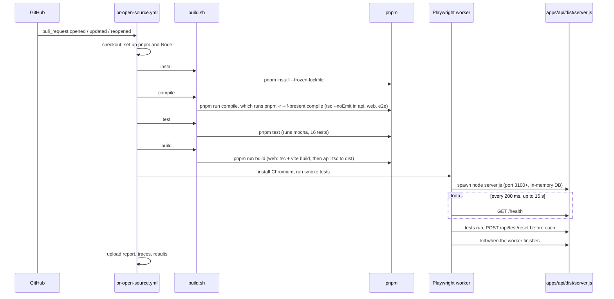

# Verbose: PR open, source path (CI only)

This expands the "What happens" section of [README.pr-open-source.md](README.pr-open-source.md). It follows the code path of the CI job and names every file and line that runs.

**Scope:** it covers how the code is installed, checked, built and launched. The Playwright test files themselves (specs and page objects) are left out. The one Playwright file that is included is the fixture that starts the app, because that is where "run from source" actually happens.

## The path at a glance

## Step by step

### 0. Trigger and job setup
[.github/workflows/pr-open-source.yml](.github/workflows/pr-open-source.yml)

- Lines 3-5: runs on `pull_request` events (opened, new commits, reopened) targeting `main`.
- Lines 7-9: a new push to the same PR cancels the run in progress.
- Lines 11-12: read-only repository access.
- Lines 15-18: one job, `e2e-source`, on `ubuntu-latest`, with a 15-minute timeout. This job name is what branch protection would require.

### 1. Runner preparation
Same workflow file.

- Line 20: `actions/checkout` puts the PR's merge commit on the runner.
- Line 23: `pnpm/action-setup` installs pnpm at the version in [package.json line 8](package.json#L8) (`packageManager`).
- Lines 25-28: `actions/setup-node` installs Node 24 and turns on the pnpm cache. Unlike the container flow, these two steps matter for everything that follows, because the app is built and run directly on the runner.

### 2. Install
Workflow line 30 runs `./build.sh install`.

[build.sh](build.sh):
- Lines 3-4: strict mode (`set -euo pipefail`), then move to the script's own folder.
- Line 11: pick the task. Line 14 is `install`.
- Line 14: `pnpm install --frozen-lockfile`. [pnpm-workspace.yaml](pnpm-workspace.yaml) lists the packages (`apps/*` and `e2e`), so this installs all three: `@qgl/api`, `@qgl/web` and `ai-ci-reference-e2e`, including dev tools. `--frozen-lockfile` fails the step if `pnpm-lock.yaml` does not match the manifests, which catches a forgotten lockfile update. Lines 5-7 of that file (`allowBuilds`) let esbuild's install script run.

### 3. Compile (type checks)
Workflow line 31 runs `./build.sh compile`, which is [build.sh line 15](build.sh#L15), `pnpm run compile`.

- [package.json line 14](package.json#L14): `pnpm -r --if-present compile` runs the `compile` script in every workspace package that has one.
- [apps/api/package.json line 9](apps/api/package.json#L9): `tsc --noEmit`, using [apps/api/tsconfig.json](apps/api/tsconfig.json). Its `include` (line 13) covers `src` and `test`.
- [apps/web/package.json line 8](apps/web/package.json#L8): `tsc --noEmit`, using [apps/web/tsconfig.json](apps/web/tsconfig.json).
- [e2e/package.json](e2e/package.json): `tsc --noEmit`, using [e2e/tsconfig.json](e2e/tsconfig.json), including its `@fixtures`, `@pages` and `@components` path aliases (lines 10-14).

Nothing is written to disk. A type error in any package fails the step.

### 4. Unit and API tests (Mocha)
Workflow line 32 runs `./build.sh test`, which is [build.sh line 16](build.sh#L16), `pnpm test`.

- [package.json line 15](package.json#L15): `pnpm --filter @qgl/api test`.
- [apps/api/package.json line 10](apps/api/package.json#L10): `mocha`.
- [apps/api/.mocharc.json](apps/api/.mocharc.json): `import: tsx` lets Mocha run the TypeScript files directly with no build step, and `spec` finds `test/**/*.test.ts`.
- The two files run are [apps/api/test/validation.test.ts](apps/api/test/validation.test.ts) and [apps/api/test/api.test.ts](apps/api/test/api.test.ts). The second starts the real Express app from `src/app.ts` on a random port (`listen(0)`) with an in-memory database ([lines 8-11](apps/api/test/api.test.ts#L8-L11)) and calls it over HTTP. It does not touch the build output.

Results appear in the job log only (16 tests). This flow does not write a JUnit file for them.

### 5. Build
Workflow line 33 runs `./build.sh build`, which is [build.sh line 18](build.sh#L18), `pnpm run build`.

[package.json line 12](package.json#L12) runs two builds in order:
- **Web**, [apps/web/package.json line 7](apps/web/package.json#L7): `tsc --noEmit && vite build`. Vite starts from [apps/web/index.html](apps/web/index.html#L10), which loads `src/main.tsx`, and writes the static site to `apps/web/dist`.
- **API**, [apps/api/package.json line 7](apps/api/package.json#L7): `tsc -p tsconfig.build.json`. [apps/api/tsconfig.build.json](apps/api/tsconfig.build.json) (`rootDir: src`, `outDir: dist`) compiles `src/` to `apps/api/dist/`, including `server.js`.

Why this matters for the next step: the tests do not use source files. They run `apps/api/dist/server.js` and the built site in `apps/web/dist`.

### 6. Playwright launch
Workflow lines 35-41. The test files are out of scope here, but this is how the app is launched.

- Lines 35-36: install Chromium and its operating-system libraries.
- Lines 38-41: `pnpm --filter ai-ci-reference-e2e test:smoke` with `CI=true`. [e2e/package.json](e2e/package.json) maps it to `playwright test --grep @smoke`, which reads [e2e/playwright.config.ts](e2e/playwright.config.ts):
  - Line 5: `fullyParallel: true`. No `workers` value is set, so Playwright uses its default of half the CPU cores.
  - Lines 6-7: `CI` turns on `forbidOnly` and one retry.
  - Lines 8-12: three reporters: console list, HTML, and JUnit at `test-results/junit.xml`.
  - Lines 13-16: traces and screenshots are kept only for failures.
  - Lines 17-27: two projects, `ui` (Desktop Chrome) and `api` (no browser).

### 7. How each worker starts the app
[e2e/src/fixtures/baseTest.ts](e2e/src/fixtures/baseTest.ts), the `workerServer` fixture (lines 34-57). Worker-scoped, so it runs once per worker process, before that worker's first test.

1. Line 36: `findUp('pnpm-workspace.yaml')` locates the repository root, so the spawn works from any folder.
2. Line 39: port = `3100 + parallelIndex`, so concurrent workers never share a port.
3. Lines 41-45: `spawn(node, ['apps/api/dist/server.js'])` with `PORT`, `DB_PATH=:memory:` and `ENABLE_TEST_RESET=true`.
4. Line 47: `waitForHealth()` (lines 9-21) polls `GET /health` every 200 ms for up to 15 seconds, and fails at once if the process exits.
5. Line 48: `use({ url })` hands the URL to the tests. Lines 58-60 turn it into Playwright's `baseURL`, so `page.goto('/')` and `request` calls reach this worker's server.
6. Lines 49-54: when the worker finishes, the server is killed and awaited.

Before every test, `resetData` (lines 61-68, automatic) sends `POST /api/test/reset` and asserts a 204.

### 8. What runs inside each spawned server
`node apps/api/dist/server.js`, compiled from [apps/api/src/server.ts](apps/api/src/server.ts):
- Lines 9-11: read `PORT`, `DB_PATH` and `WEB_DIST`. `WEB_DIST` defaults to `apps/web/dist`, relative to the build output, so the site built in step 5 is served.
- Line 13: skip creating a folder, because `DB_PATH` is `:memory:`.
- Line 14: `openDb()` ([db.ts lines 31-35](apps/api/src/db.ts#L31-L35)) opens an in-memory SQLite database and creates the `runs` table from lines 18-27.
- Line 15: `seedIfEmpty()` ([seed.ts lines 40-43](apps/api/src/seed.ts#L40-L43)) inserts the 8 fixed runs.
- Line 17: `createApp()` ([app.ts](apps/api/src/app.ts)) builds the routes: `/health` (lines 17-22), `/api/runs` (line 24 onward), the reset route (lines 82-87, only because reset is enabled), and static hosting of the web build (lines 93-95).
- Line 18: listen on the worker's port.

Each worker therefore has its own isolated, freshly seeded database.

### 9. Upload
Workflow lines 43-51 (`if: !cancelled()`): upload `e2e/playwright-report/` and `e2e/test-results/` as `playwright-diagnostics`, kept for 7 days. It runs after failures too. There is no cleanup step, because the runner is discarded after the job.

## Files that run, in order

| Order | File | Role |
|---|---|---|
| 1 | `.github/workflows/pr-open-source.yml` | Defines the job and its steps |
| 2 | `package.json` | Pins pnpm (line 8); defines `compile`, `test` and `build` |
| 3 | `build.sh` | `install`, `compile`, `test`, `build` |
| 4 | `pnpm-workspace.yaml`, `pnpm-lock.yaml` | Define and pin the workspace installs |
| 5 | `apps/*/package.json`, `apps/*/tsconfig*.json`, `e2e/tsconfig.json` | Type checks and builds |
| 6 | `apps/api/.mocharc.json`, `apps/api/test/*` | Mocha tests |
| 7 | `apps/web/*` | Built into the static site |
| 8 | `apps/api/src/*` | Compiled to `dist/` and run as the test servers |
| 9 | `e2e/playwright.config.ts`, `e2e/src/fixtures/baseTest.ts` | Run settings and per-worker server start-up |

Not used in this path: any Docker or Jenkins file. The Playwright specs and page objects run in step 6, but are not walked through here.
